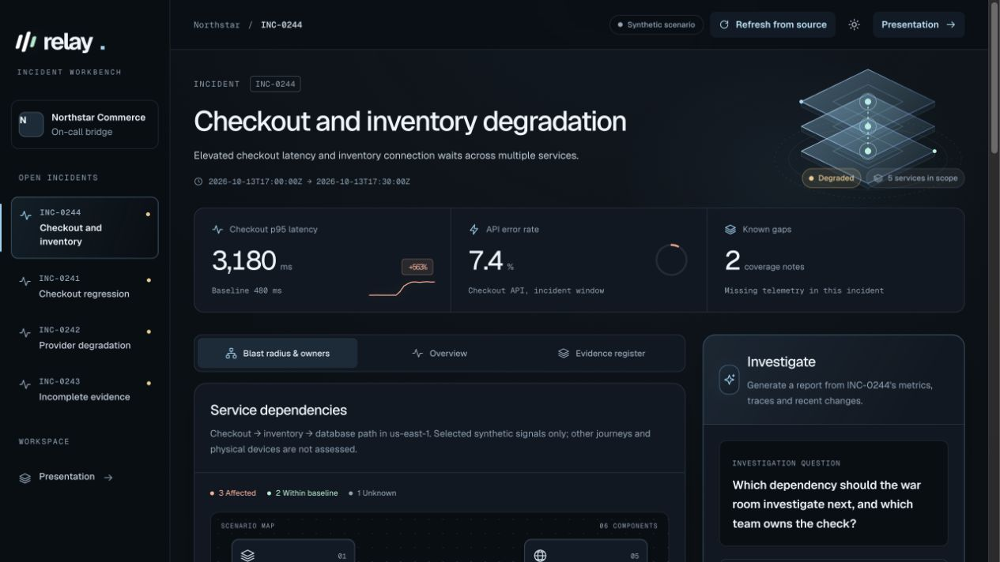

# Relay

[](https://github.com/exuepdx/relay-incident-workbench/actions/workflows/ci.yml)

An incident workbench for investigating a retail checkout outage across application,
database and network teams. Relay combines a dependency map, team handoffs and an
AI-generated report linked to the telemetry retrieved during each investigation.

The scenario comes from enterprise observability work: teams have dashboards, but
still spend outage calls correlating symptoms and establishing ownership. Northstar
Commerce and its telemetry are fictional. The dependency map and handoffs are
prepared scenario context; the report is generated by the agent.

**[Live demo](https://relay-incident-workbench.vercel.app/incidents/INC-0244)** ·
**[Presentation](https://relay-incident-workbench.vercel.app/proposal?present=1)** ·
**[Design decisions](docs/decisions.md)**



## Try it

Open INC-0244 and inspect the service owners and evidence citations. To generate a
report, enter the separately shared reviewer code in **Investigate**, select
**Unlock**, then **Run investigation**. Existing saved reports are public; no
account is needed to read them. The demo records approval decisions but executes
no operational changes.

For the walkthrough, use the [twelve-minute demo script](docs/demo-script.md).
The presentation covers the customer problem, architecture, trade-offs, proposed
pilot measures and rollout. Technical details and product feedback are in its appendix.

## Architecture

Next.js on Vercel renders a static shell, caches the incident catalog and streams
live investigation status. A Vercel Workflow runs the AI SDK agent with three
read-only tools against a separately deployed telemetry API. AI Gateway provides
model access and cost accounting. Reports and approval records persist in Neon Postgres.

Before displaying a report or approval request, Relay validates citations, owners
and known policy constraints against the run's actual tool transcript. Each report
retains that evidence snapshot. These checks catch known failure modes; they do
not establish that every generated conclusion is correct.

The demo telemetry API runs in a separate Vercel project. An AWS Lambda adapter is
included; the hosted demo does not run its backend on AWS. The fictional customer
stack uses EKS, RDS Postgres, Jenkins and an existing observability platform to
illustrate the integration boundary.

## Verification

| Check                             | Recorded result                                                             | Evidence                                                                                            |
| --------------------------------- | --------------------------------------------------------------------------- | --------------------------------------------------------------------------------------------------- |
| Unit and regression tests         | 36 passed                                                                   | [CI](https://github.com/exuepdx/relay-incident-workbench/actions/workflows/ci.yml)                  |
| Primary live model evaluation     | 8 cases passed, collected in two batches under the same prompt and contract | [Results and provenance](artifacts/evaluation.json)                                                 |
| Hosted workflow scenarios         | 7 expected outcomes passed, including deliberate failure                    | [Smoke results](artifacts/deployment-smoke.json)                                                    |
| Production promotion and rollback | Saved report and evidence remained readable and unchanged                   | [Continuity](artifacts/deployment-continuity.json) · [Rollback](artifacts/deployment-rollback.json) |
| Latest UI and copy deployment     | Public routes passed; saved report unchanged                                | [Verification](artifacts/interface-copy-verification.json)                                          |

The [artifact index](artifacts/README.md) separates current results from earlier
failed attempts. The [repair record](docs/repair-verification.md) explains what
those failures changed. Automated checks do not substitute for reviewing a report
against its sources.

## Run locally

Use Node 22. Start the telemetry API and application in separate terminals:

```sh
npm ci
cp .env.example .env.local
npm run customer-api               # terminal 1, port 4319
npm run dev -- --webpack           # terminal 2, http://127.0.0.1:3000
```

The local reviewer code is `DEMO_ACCESS_CODE` in `.env.local`. Live model calls
need `AI_GATEWAY_API_KEY`. For offline development, set
`RELAY_FAKE_GATEWAY_URL=http://127.0.0.1:4321` and `AI_GATEWAY_API_KEY=fake`, then
start the simulator in a third terminal:

```sh
npx tsx scripts/fake-gateway.ts
```

The fake Gateway tests orchestration and UI behavior. Its reports, prices and
served-model values are simulated.

## Run checks

```sh
npm test
npm run typecheck
npm run typecheck:customer-api
npm run build
```

Hosted smoke and live evaluations require the appropriate ignored environment
file and use model credit:

```sh
DEMO_ACCESS_CODE=... npm run smoke
SMOKE_PAUSE=1 DEMO_ACCESS_CODE=... npm run smoke
npm run eval -- --delay-ms=65000
npm run probe:fallback
```

See [deployment instructions](docs/deploy.md) for environment variables and
preview testing. CI checks every PR. Deployment and promotion currently use the
CLI; the optional GitHub preview integration is not configured.

## Code guide

| Path                                             | Purpose                                                   |
| ------------------------------------------------ | --------------------------------------------------------- |
| `app/incidents/[id]`                             | Workbench, cached catalog and live status                 |
| `app/api/investigations`                         | Start, status, approval and progress endpoints            |
| `workflows/`                                     | Durable steps, retry and approval waits                   |
| `lib/agent.ts`, `lib/tools.ts`, `lib/gateway.ts` | Agent instructions, tool definitions and model accounting |
| `lib/contracts.ts`, `lib/run-validation.ts`      | Schemas and validation against retrieved evidence         |
| `lib/store.ts`, `lib/store-postgres.ts`          | Report persistence and idempotent start reservations      |
| `customer-api/`                                  | Synthetic telemetry service and deployment adapters       |
| `scripts/`, `tests/`, `artifacts/`               | Evaluation harnesses, regressions and recorded results    |

## Scope and development

The primary model is `openai/gpt-5.2`. Automatic cross-model fallback is disabled
because the comparison candidate failed a report-quality check. Explicit comparison
and provider-outage drills remain available. Production adoption would require
verified owner identity, data-retention decisions and scoped integration access;
coordination improvements remain proposed pilot targets.

Codex assisted the initial implementation and subsequent repairs; Fable supplied a
substantial rebuild. Both source histories and the failed evaluation attempts are
preserved. [Design decisions](docs/decisions.md) connects the current implementation
to the alternatives considered and the changes made after testing.

[Maintainer handoff](HANDOFF.md) · [Product feedback](docs/product-feedback.md)
