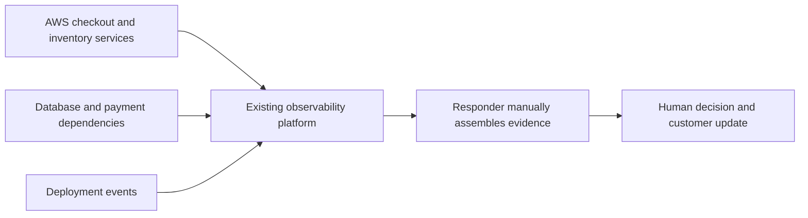
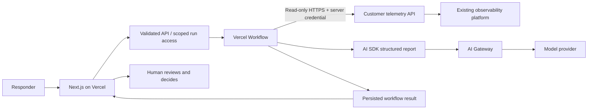

# Relay — from signals to a next step

An evidence-first incident workbench for a fictional enterprise retailer. The
customer already has observability; Relay helps responders assemble the relevant
evidence, assess a hypothesis, and prepare a clear customer update.

- **Demo:** https://relay-incident-workbench.vercel.app
- **Customer proposal:** https://relay-incident-workbench.vercel.app/proposal
- **Repository:** https://github.com/exuepdx/relay-incident-workbench
- **Mock service:** https://relay-telemetry-mock.vercel.app/api/telemetry
  (requires a server-only token)

All telemetry and customer details are synthetic. The mock represents an existing
customer API and is deployed separately on Vercel; it is not hosted on AWS and is
not an integration with a commercial observability vendor.

## Try it

1. Choose **Checkout regression** and run an **Authored sample** investigation.
   This crosses the real authenticated HTTP boundary and runs a durable workflow,
   but returns a clearly labeled authored report with no model call.
2. Inspect a finding's evidence citation. Export the JSON or copy the customer update.
3. Under **Test resilience**, select **First request returns 503** and run again.
   Run details should show two retrieval attempts. **Persistent 503 outage** must
   fail without producing a diagnosis.
4. Refresh, open **Saved investigations**, and reconnect to a run.
5. Choose **Live AI** and enter the reviewer code supplied separately. Live AI
   requires enabled Gateway access; sample mode is never silently substituted.

The public UI and samples need no login. Live inference uses a one-hour reviewer
session. The access code is deliberately absent from the public repository.

## The architecture

Current state:



Target state:



What stays: AWS workloads, Postgres, telemetry ingestion/storage/retention,
alerting, and operational ownership. The demo has no arbitrary query tool,
production credentials, or remediation action. Bounded evidence is passed to the
model; retained step inputs and outputs are also data that must be governed.

## Vercel choices

| Primitive                 | Deliberate role                                   | Trade-off                                                      |
| ------------------------- | ------------------------------------------------- | -------------------------------------------------------------- |
| AI SDK                    | Schema-validated report generation                | Structural validity is not semantic truth                      |
| AI Gateway                | Model access, token/cost metadata, project budget | Provider behavior and data policies still matter               |
| Workflows                 | Durable steps and retained results                | Adds state, versioning, retention, and recovery concerns       |
| Functions / Fluid Compute | API routes and workflow steps                     | External service capacity and cross-cloud latency still matter |
| Preview Deployments       | Review deployment changes                         | Preview environment must not expose production data            |

No cross-model fallback is configured. Gateway can route/fail over among providers
of the same model under its default policy; SDK and workflow retry settings do not
disable that service-level routing. We did not inject a Gateway provider outage.
See [Gateway routing](https://vercel.com/docs/ai-gateway/models-and-providers/provider-options).
`AI_MODEL` is a server setting; rerun
the evaluation rubric when changing it. Retrieval retries twice with a delay;
model generation does not automatically retry because a lost response may still
be billed. The project has a $1 non-refreshing Gateway budget; budgets are not a
hard zero-overshoot guarantee for requests already in flight.

## Run locally

Use Node.js 22 and npm. Vercel production is pinned to Node 22.

```sh
npm ci
cp .env.example .env.local
npm run mock
# In another terminal:
npm run dev
```

Open http://127.0.0.1:3000. The separate mock listens on port 4319. For local live
AI, configure `AI_GATEWAY_API_KEY`, or use a valid Vercel project OIDC session.
Set `ENABLE_LIVE_AI=true` only after verifying credits/model access. Never commit
credentials. Local `.env*`, `.vercel`, and workflow state are ignored.

Required production configuration:

| Variable              | Purpose                                                  |
| --------------------- | -------------------------------------------------------- |
| `TELEMETRY_API_URL`   | Fixed HTTPS endpoint; callers cannot override it         |
| `TELEMETRY_API_TOKEN` | Server-only credential shared with the synthetic service |
| `SESSION_SECRET`      | Random secret for session and run capabilities           |
| `DEMO_ACCESS_CODE`    | Shared reviewer gate for live inference                  |
| `ENABLE_LIVE_AI`      | Explicit live inference switch                           |
| `AI_MODEL`            | Gateway model ID (default `openai/gpt-5.2`)              |

Vercel deployments use OIDC for Gateway; a provider key is not shipped to the
browser. Production and preview configuration are distinct Vercel targets. The
demo targets share the same synthetic service; a customer pilot should use
separate credentials and isolated test data.

## Validation

```sh
npm test
npm run typecheck
npx tsc -p mock/tsconfig.json --noEmit
npm run build
npm run smoke
# Live AI eval; consumes model allowance:
npm run eval
# Hosted live integration test; uses the reviewer code from your local secret file:
DEMO_URL=https://relay-incident-workbench.vercel.app node --env-file=.env.deploy --import tsx scripts/live-smoke.ts
```

`scripts/smoke.ts` supports `DEMO_URL` for deployed checks. It verifies a successful
run, transient retry, persistent failure, retrieval of persisted results, invalid
input rejection, cross-origin rejection, and denied unscoped reads. It uses
sample mode and makes no model calls.

`scripts/evaluate.ts` tests the three incident cases plus instructions embedded in
an untrusted log. It validates structure and citations and saves reports for human
review. Review source support, appropriate uncertainty, counter-evidence, and safe
next steps. A small test set is not a statistically robust evaluation.

The default model is `openai/gpt-5.2`. See the preserved comparison failures and
[evaluation review](docs/evaluation-review.md) for the choice and its limits.

See [assessment coverage](docs/brief-audit.md), [verification](docs/verification.md), [presentation notes](docs/presentation.md),
[architectural decisions](docs/decisions.md), and [product feedback](docs/product-feedback.md).

## Deployment and rollout

The mock deploys from `mock/`; the application deploys from the repository root.
Both target iad1. First deploy the mock and verify an authenticated request, then
configure and deploy the application. Model inference, workflow state, and logs
have separate placement concerns; an application region is not a residency guarantee.

Use preview → contract/AI validation → small responder cohort → expansion.
Native traffic-percentage Rolling Releases are not part of this Hobby demo.
Before promoting a preview, verify its environment configuration and access.

These deployments were created with the Vercel CLI. Automatic GitHub deployments
are not connected: Vercel requires the account owner to add a GitHub Login
Connection before the repository can be linked. CLI previews remain available.

For rollback, restore the previous compatible application deployment or remove
pilot access. Restoring application code does not undo workflow results, database
changes, or external side effects. This demo performs no operational writes.

## Known limits

- The charts are illustrative fixed snapshots; the investigation fetches the
  authoritative synthetic evidence bundle from the separate service. This is not
  live production monitoring or an OTLP collector.
- The shared reviewer code is not SSO or tenant isolation. Run capabilities are
  scoped to one run but remain valid while the signing secret and retained run do.
- History stores the latest 12 run references in this browser. Workflow state
  persists separately. Browser storage deletion loses the local index.
- No global application rate limiter or request deduplication. Fixed inputs,
  token limits, reviewer access, and the Gateway budget bound some risks, not all.
- No guarantee that a citation actually supports a claim; human review remains.
- No claim of measured MTTR/revenue improvement. Establish a customer baseline and
  compare responder effort and time to an approved update in a pilot.
- Durable execution is not exactly-once inference billing. A successful remote
  model call followed by a lost response/checkpoint can still create uncertainty.

## Development tooling

Built using Codex in a local workspace, npm, TypeScript, Vercel CLI, GitHub CLI,
and browser inspection. The real incremental commit history is retained. No
customer engagement, performance benchmark, or human review result is fabricated.
The candidate should review and rehearse the implementation before submission.
